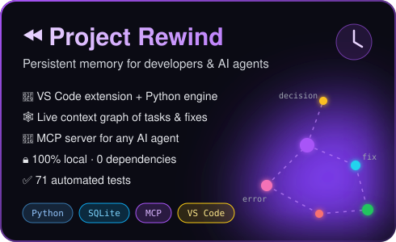
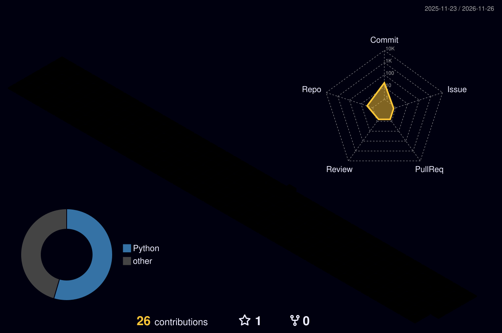

  

  
  
  

  

<h2 align="center">⚡ Arsenal</h2>

    
  

  
  
  
  
  
  

<h2 align="center">🚀 Things I've built</h2>

  
  

<h2 align="center">🏙️ My contribution skyline</h2>

  <picture>
    <source media="(prefers-color-scheme: dark)" srcset="./profile-3d-contrib/profile-night-rainbow.svg" />
    <source media="(prefers-color-scheme: light)" srcset="./profile-3d-contrib/profile-green-animate.svg" />
    
  </picture>

<h2 align="center">📊 By the numbers</h2>

  
  

  

  <picture>
    <source media="(prefers-color-scheme: dark)" srcset="https://raw.githubusercontent.com/Dritikakotian/Dritikakotian/output/github-snake-dark.svg" />
    <source media="(prefers-color-scheme: light)" srcset="https://raw.githubusercontent.com/Dritikakotian/Dritikakotian/output/github-snake.svg" />
    
  </picture>

  
  <!-- To add: replace # with your link and remove the comment markers
  
  
  -->

✨ Built with curiosity, caffeine and a lot of <code>git push</code> ✨

